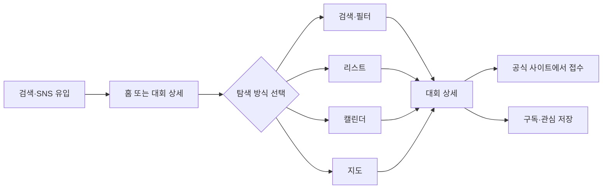

# 서비스 분석: 런조아 (runzoa.com)

기준일 2026-10-21. 직접 확인한 내용과 추정을 구분했습니다. 원문 문구는 옮기지 않고 요약했습니다.

## 1. 서비스 개요

| 항목 | 내용 |
| --- | --- |
| 한 줄 정의 | 전국과 해외 마라톤·러닝 대회 정보를 모아 검색, 목록, 캘린더, 지도로 보여 주는 정보 플랫폼 |
| 운영 | 1인 제작자(Webstoryboy)가 운영하는 여러 서비스 중 하나(추정: 1인 운영) |
| 시점 | 2026.01 알파 → 03 베타 → 04 v1.0 런칭 → 08 v2.0 전면 리뉴얼 |
| 규모 | 현재 확인 가능한 대회 173건(접수중 77건), 2024~2026 아카이브 442건 |
| 타깃 | 참가할 대회를 찾는 일반 러너 |
| 핵심 가치 | 대회를 찾는 시간을 줄인다. 공식 출처 기준의 정확한 일정·접수 정보 |
| 수익 모델 | 확인되지 않음. 광고나 결제 화면은 보이지 않음 |
| 기술 관찰 | Next.js 서버 렌더링, Google Analytics, 네이버·카카오 지도 외부 링크 |

## 2. 핵심 기능

1. 탐색 4방식: 조건 검색, 리스트 비교, 캘린더, 지도(지도는 아직 좌표 목록 수준)
2. 대회 상세: 일정, 접수 기간, 종목별 참가비, 장소, 주최·연락처, 공식 사이트 링크
3. 접수 상태 중심 큐레이션: 접수 예정, 접수중(마감 임박순), 이번 달
4. 콘텐츠: 공지, 업데이트, 주간 뉴스레터, 블로그(후기, 월별 일정 총정리, 러닝 팁)
5. 회원 기능: 소셜 로그인, 관심 대회 저장, 접수 알림(소개·약관 문구 기준, 화면은 미확인)
6. 외부 연결: 접수는 공식 사이트로 이동. 참가 신청과 결제는 중개하지 않음
7. 운영 지원: 4유형 문의 폼, 연도별 아카이브, 좌표 변환 도구, 공개 통계 리포트

## 3. 사용자 여정

유입은 네이버 검색이 확인 가능한 웹 유입의 약 72%이고 Instagram이 세 번째입니다. 대회 상세가 사실상 종착점이고, 접수는 외부에서 이뤄집니다.

## 4. 강점

- 접수 상태와 마감 임박 표시가 홈과 목록 모두에서 일관됩니다("오늘 마감", "마감 D-N").
- 같은 데이터를 목록, 달력, 지도 4가지 방식으로 보여 줍니다.
- 정보 출처와 수정 정책이 문서로 공개되어 신뢰 장치가 있습니다.
- 서버 렌더링, 대회별 고유 URL, 블로그로 검색 유입을 만들고 있습니다.

## 5. 약점과 기회

| 구분 | 내용 | 근거 |
| --- | --- | --- |
| 지도 미완성 | 실제 지도 타일이 없고 좌표 기반 목록만 있음 | SCR-005 |
| 캘린더 연동 베타 | 외부 캘린더 추가가 아직 작동하지 않음 | SCR-017 |
| 재방문 장치 약함 | 운영자 리포트가 재방문 지표와 알림·구독 CTA 강화를 과제로 꼽음 | SCR-018 |
| 채널 편중 | 네이버 검색 의존도가 높음 | SCR-018 |
| 커뮤니티 부재 | 참가 이력, 기록, 커뮤니티는 "준비 중" | SCR-011 |
| 사람 연결 없음 | 참가자끼리 연결되는 기능이 없음 | 전체 화면 |

## 6. TogeRun에 주는 시사점

- "대회 정보"는 이미 잘 정리된 영역이라 정보 자체로 경쟁하기 어렵습니다. TogeRun은 대회 정보를 바탕에 두고 "같이 갈 사람"을 얹는 편이 맞습니다.
- 런조아가 비어 둔 커뮤니티 자리가 TogeRun의 핵심입니다. 다만 런조아도 이 영역을 "준비 중"으로 표시하고 있어, 후속 추격 가능성이 있습니다.
- 접수를 외부로 넘기는 구조와 공식 출처 우선 정책은 PRD의 저작권·정확성 방향과 일치합니다.

자세한 비교는 [07_TogeRun_적용방안.md](07_TogeRun_적용방안.md)를 참고하세요.

## 7. 미확인 / 한계

- 로그인 후 화면과 실제 알림 동작은 확인하지 못했습니다(`/auth/`, `/mypage`는 robots.txt 금지).
- 수익 구조와 운영 비용은 화면에서 알 수 없습니다.
- 사용자 규모는 공개 통계 리포트(웹 활성 사용자 약 4.4천, 최근 28일, 2026-08 기준)에서만 확인했습니다.
