# 화면명세서 (런조아 분석) — 배치 1

공통: 상단 GNB(홈 로고, 검색·리스트·캘린더·지도·블로그, 모바일 메뉴 열기 버튼), 상단 대회 검색창(대회명·지역·장소), 하단 푸터(서비스·소식·지원·정책·아카이브 링크, SNS 링크). 확인하지 못한 항목은 "미확인"으로 표시했습니다.

공통 대회 카드 필드: 종류 뱃지(마라톤·트레일러닝·자전거 등), D-day, 접수 상태(접수 예정·접수중·접수 마감), 대회명, 개최일, 접수일, 장소(지역·장소), 종목, 참가비 범위, 규모(약 N명 또는 "규모 확인").

## SCR-001 홈 (`/`)

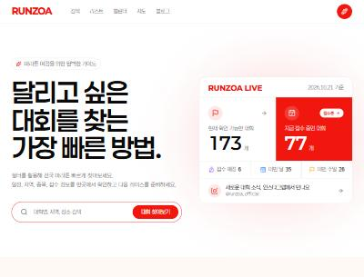

- 목적: 대회 탐색의 진입점. 핵심 수치와 4가지 탐색 방식을 안내
- 구성

| 번호 | 영역 | 요소 | 동작 |
| --- | --- | --- | --- |
| 1 | 히어로 | 슬로건, 검색 입력, [대회 찾아보기] | 검색어로 대회 검색(검색 결과 이동 경로는 미확인) |
| 2 | 라이브 카드 | 기준일, 현재 확인 가능한 대회 수, 접수중 수, 접수 예정·이번 달·이번 주말 건수 | 각 수치가 리스트·캘린더 링크(`?status=`, `?month=`) |
| 3 | 탐색 방식 | 조건으로 찾기·목록으로 비교·달력으로 확인·지도로 둘러보기 4카드 | 각 서비스 화면으로 이동 |
| 4 | 지도 소개 | 지도 열기, 달력 보기 버튼 | 이동 |
| 5 | 접수 예정 | 곧 접수가 시작되는 대회 카드(날짜, D-day, 접수 시작일시) | 대회 상세로 이동 |
| 6 | 이번 달 | 이번 달 남은 대회 개수와 개최일순 카드 | 상세 이동, "전체 달력 보기" |
| 7 | 접수중 | 마감 임박순 카드("오늘 마감", "마감 D-N") | 상세 이동, 접수 중 전체 보기 |
| 8 | 뉴스레터 | 구독하기 버튼 | 동작 미확인(제출하지 않음) |
| 9 | SNS | 인스타그램 링크 | 새 창 |

- 데이터: 대회 수 집계, 상태별 필터링, D-day 계산(개최일·접수일 기준)
- 예외: 마감 당일은 "오늘 마감"으로 표시
- 관련 요구사항: FR-001~FR-004, FR-012

## SCR-002 대회 검색 (`/marathon-search`)

- 목적: 조건을 조합해 대회를 좁혀 찾기
- 구성: 검색창, 좌측 필터 패널, 결과 카드 목록, 정렬 드롭다운, [대회 더보기]

| 필터 | 유형 | 선택지 |
| --- | --- | --- |
| 지난 대회 | 토글 | 비포함(기본)/포함 |
| 접수 상태 | 다중 버튼 | 접수 예정·접수중·접수 마감 |
| 개최 규모 | 버튼 | 5천명 이하·5천~1만명·1만~2만명·2만명 이상 |
| 개최 연도 | 버튼 | 2026년·2027년 |
| 개최 월 | 버튼 | 1~12월 |
| 거리 | 버튼 | 5Km·10Km·Half·Full |
| 개최 지역 | 콤보박스 | 전체 외 지역 목록 |
| 대회 종류 | 콤보박스 | 전체 외 종류 목록 |

- 정렬: 기본 "개최일 빠른순"(다른 정렬 옵션은 미확인)
- 결과: "조건에 맞는 대회 N개" 문구와 건수, 카드 목록
- 상태: 이미지 로딩 중 표시 확인. 빈 결과, 에러 화면은 미확인
- 관련 요구사항: FR-005~FR-007

## SCR-003 대회 리스트 (`/marathon-list`)

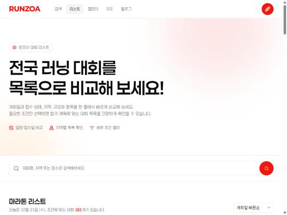

- 목적: 전체 대회를 카드로 한눈에 비교
- 구성: 검색창, 정렬(개최일), 필터(접수 상태·종류·연도·월·지역·규모·지난 대회), [필터 초기화], 카드 목록, [대회 더보기]
- 페이징: 초기 30건 노출 후 "더보기" 버튼으로 추가 로딩(무한 스크롤이 아님)
- 카드: 날짜(일·요일), D-day, 종류, 접수 상태, 대회명, 장소, 참가비, 종목, 규모
- URL 파라미터: `status=open|upcoming`
- 관련 요구사항: FR-005~FR-008

## SCR-004 대회 캘린더 (`/marathon-calendar`)

- 목적: 월별 일정과 같은 날 열리는 대회 비교
- 구성: 월 이동(이전 달·오늘·다음 달), 월간 달력 그리드, 날짜 셀(대회명 최대 2개 + "+N개 더보기"), 선택 날짜 일정 영역, 지역·종류 필터
- 동작
  1. 날짜 셀 클릭 → 하단에 "YYYY년 M월 D일 일정 N" 영역과 해당일 대회 카드 링크 표시
  2. 대회가 없는 날 → "선택한 날짜에 등록된 대회가 없습니다" 문구
  3. "(취소)" 대회는 대회명에 표기되어 달력에 함께 노출
- URL 파라미터: `month=YYYY-MM`
- 관련 요구사항: FR-009~FR-010

## SCR-005 대회 지도 (`/marathon-map`)

- 목적: 지역별로 개최 위치를 보고 대회 선택
- 구성: 검색창, 지역 칩(전체 + 17개 시도), 지도에서 확인 가능한 대회 수, 마커/카드 목록(종류·접수 상태·날짜·대회명·장소·종목·참가비·규모)
- 관찰: 화면 안내 문구에 "외부 지도 API 연결 전에는 등록된 위도·경도 기준으로 위치를 표시"라고 되어 있고, 카카오·네이버·구글 지도 라이브러리는 로드되지 않았습니다. 즉 실제 지도 타일은 미구현(안내 상태)입니다.
- 데이터: 대회별 위도·경도 보유(163개/173개가 좌표 보유)
- 관련 요구사항: FR-011

---

# 배치 2

## SCR-006 대회 상세 (`/marathon/{slug}`)

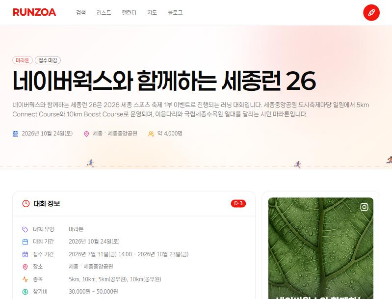

- 목적: 한 대회의 정보·일정·접수·위치를 한 페이지에서 확인
- 진입: 모든 카드, 캘린더 날짜 목록, 지도 목록. slug는 `대회명-연도` 형태(예: `...-2026`)
- 구성

| 번호 | 영역 | 요소 | 동작 |
| --- | --- | --- | --- |
| 1 | 히어로 | 종류·접수 상태 뱃지, 대회명, 소개 문단, 개최일·장소·규모 | - |
| 2 | 대회 정보 카드 | D-day, 유형, 대회 기간, 접수 기간, 장소, 종목, 참가비, 규모, 주최·주관, 연락처(전화 링크), 인스타그램, 주차, 기념품, 메모 | 전화·SNS 링크, 외부 "대회 사이트" 링크 |
| 3 | 대회 포스터 | 이미지(인스타그램 링크 표시) | 외부 링크 |
| 4 | 대회 기간 | 시작·종료 일시, 상세 일정 표(없으면 "등록된 상세 일정이 없습니다") | - |
| 5 | 접수 정보 | 접수 시작·마감 일시, 종목별 참가비, 접수 상태 | - |
| 6 | 런조아 구독 | 뉴스레터 소개와 [구독하기] | `/newsletter`로 이동 |
| 7 | 대회 위치 | 주소, 외부 지도 링크(네이버 지도·카카오맵), [주소 복사] 버튼 | 지도 앱을 새 창으로 열기, 주소 클립보드 복사 |
| 8 | 하단 추천 | 곧 접수 오픈 예정 6개, 지금 접수 중 77개(마감 임박순), 이번 달 대회 | 각 카드에서 상세 이동 |

- 필드 구조(관찰): 대회명, 설명, 종류, 개최 시작·종료일, 접수 시작·마감 일시, 장소·주소·위도·경도, 종목별 참가비, 규모, 주최, 주관, 연락처, SNS, 공식 사이트, 주차, 기념품, 메모, 상세 일정 목록
- 상태: 접수 마감 시 "접수 마감" 뱃지. 종목별 가격이 없으면 범위로 표기
- 예외: 일정 상세가 없는 대회는 안내 문구로 대체
- 관찰: 접수 신청은 런조아 안에서 하지 않고 공식 대회 사이트로 연결합니다
- 관련 요구사항: FR-013, FR-016~FR-019

## SCR-007 소식: 공지사항·업데이트 (`/new?type=notice|updates`)

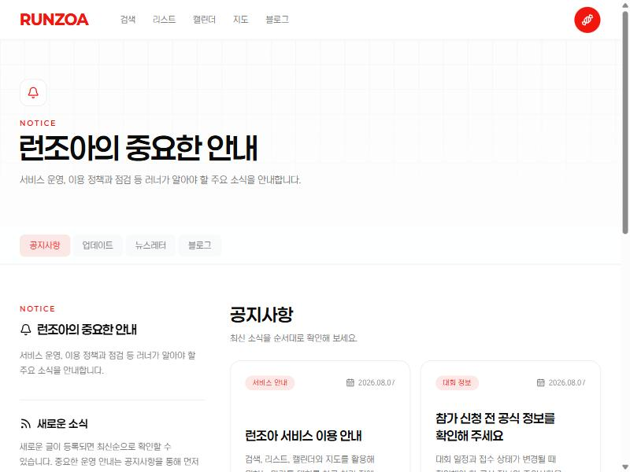

- 목적: 운영 공지와 서비스 변경 안내
- 구성: 페이지 헤더, 탭 4개(공지사항·업데이트·뉴스레터·블로그), 좌측 요약 박스("새로운 소식"), 글 카드 목록(분류 뱃지, 날짜, 제목, 요약, [글 읽기])
- 동작: 탭 클릭 시 해당 목록으로 이동, 카드 클릭 시 상세(`/new/{slug}`)
- 목록 정렬: 최신순. 페이징 없음(글 수가 적어 미확인)
- 관련 요구사항: FR-020

## SCR-008 뉴스레터 (`/newsletter`)

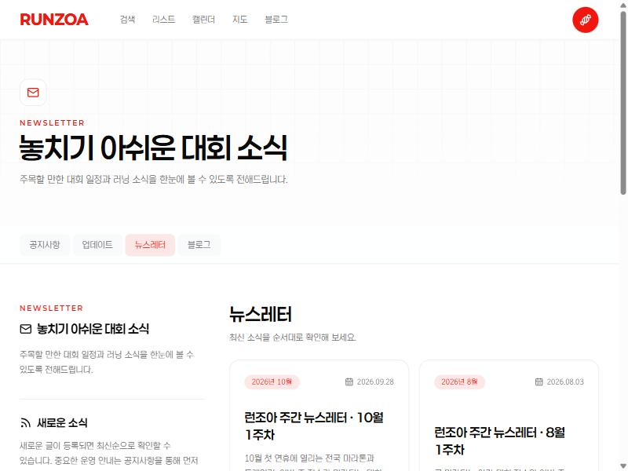

- 목적: 주간 뉴스레터 아카이브와 구독 안내
- 구성: 탭, "매주 정보를 받고 싶다면" 박스와 [뉴스레터 구독하기], 월별 뱃지가 붙은 뉴스레터 카드 목록(제목에 "주간 뉴스레터 · N월 N주차")
- 관찰: 이 화면에는 입력창이 없고 구독 버튼만 있어, 구독은 다른 화면·외부 서비스에서 처리하는 것으로 보임(추정). 버튼은 누르지 않음
- 관련 요구사항: FR-012, FR-021

## SCR-009 블로그 (`/blog`)

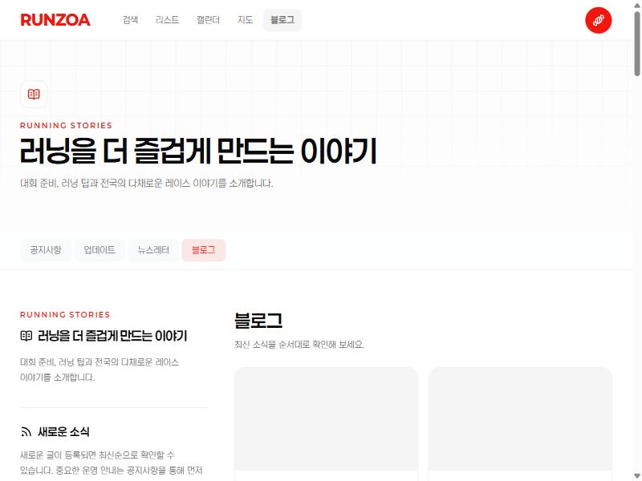

- 목적: 대회 후기, 일정 총정리, 러닝 팁 콘텐츠 제공(SEO 유입 용도로 보임, 추정)
- 구성: 탭, 글 카드 목록(카테고리 뱃지, 날짜, 제목, 요약, 이미지, [글 읽기])
- 카테고리 관찰: 대회 후기, 마라톤 일정, 러닝 가이드, 러닝 팁
- 상세: `/blog/{slug}`. 이미지는 지연 로딩(스켈레톤 표시)
- 관련 요구사항: FR-022

## SCR-010 고객지원 (`/support?type=registration|inquiry|complaint|correction`)

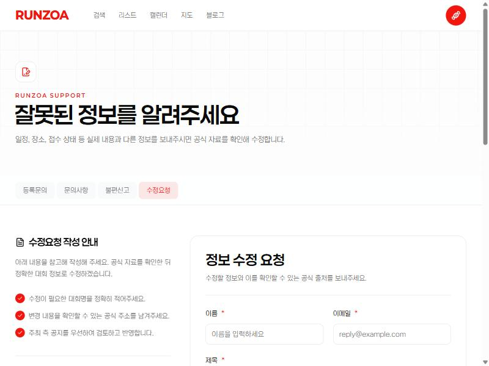

- 목적: 대회 등록 제안, 문의, 불편 신고, 정보 수정 요청 접수
- 구성: 탭 4개, 작성 안내 박스(체크 목록), 문의 처리 안내, 입력 폼

| 필드 | 필수 | 유형 | 비고 |
| --- | --- | --- | --- |
| 이름 | 필수 | 텍스트 | - |
| 이메일 | 필수 | 이메일 | 답변 수신용 |
| 제목 | 필수 | 텍스트 | - |
| 관련 페이지 주소 | 선택 | URL | 공식 출처 링크 권장 |
| 내용 | 필수 | 텍스트 영역 | 라벨이 유형별로 다름: 대회 정보 / 문의 내용 / 불편 내용 / 수정 요청 내용 |
| 개인정보처리방침 동의 | 필수 | 체크박스 | - |

- 동작: [문의하기]로 제출. 제출 결과 화면은 미확인(제출하지 않음)
- 정책: 수정은 "공식 자료 확인 후" 반영, 주최 측 공지를 우선
- 관련 요구사항: FR-014, FR-023

---

# 배치 3

## SCR-011 소개 (`/about`)

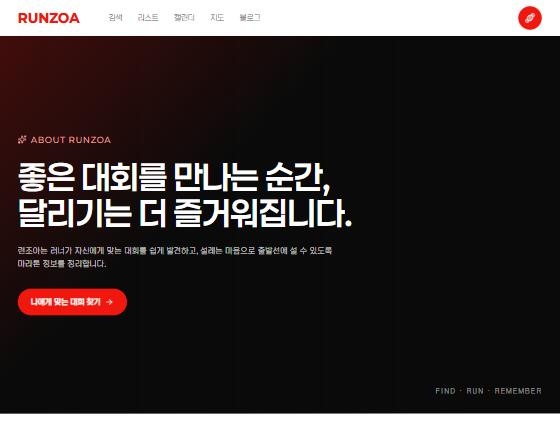

- 목적: 서비스 철학, 기능 소개, 변경 이력
- 구성: 다크 히어로와 [나에게 맞는 대회 찾기] 버튼, 서비스 소개, 기능 목록, 변경 이력(Changelog), 제작자의 다른 서비스 소개
- 기능 목록과 상태: 대회 정보, 해외 러닝 이벤트, 검색·필터, 즐겨찾기, 접수 알림은 제공 중으로 표기. 참가 이력 관리, 러닝 기록 등록, 커뮤니티는 "준비 중" 뱃지
- 변경 이력: 2026.01 알파, 2026.03 베타(해외 이벤트, 검색·필터), 2026.04 v1.0(즐겨찾기, 회원가입·로그인), 2026.08 v2.0 전면 리뉴얼
- 관련 요구사항: FR-024, FR-025

## SCR-012~014 정책 3종

| 화면ID | 경로 | 핵심 내용(요약) |
| --- | --- | --- |
| SCR-012 | `/policy` | 운영정책 12개 조: 대회 정보 수집·등록 기준, 검수와 업데이트, 등록·수정·삭제 요청, 게시 제한, 포스터 권리 보호, 이용자 안전, 이의제기 |
| SCR-013 | `/terms` | 이용약관 13개 조: 서비스 범위, 소셜 로그인 회원, 외부 서비스 책임 제한, 저작권 |
| SCR-014 | `/privacy` | 개인정보처리방침 15개 조: 수집 항목, 보유 기간, 쿠키, 보호책임자 |

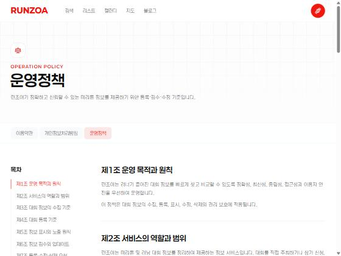
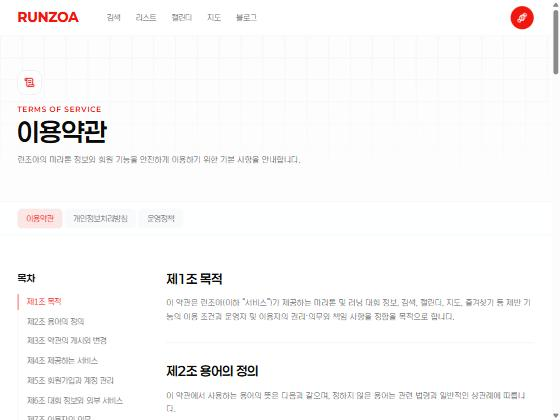
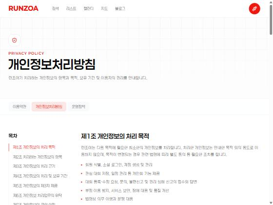

- 공통 구성: 헤더, 3개 정책 탭(이용약관·개인정보처리방침·운영정책), 좌측 목차(조항 앵커), 본문
- 동작: 목차 클릭 시 해당 조항으로 이동
- 서비스 설계에 주는 사실(요약)
  - 대회 정보는 공식 출처로 수집하고, 출처가 충돌하면 주최 측 공식 공지를 우선합니다.
  - 참가 신청·결제·환불은 중개하지 않고 외부 공식 페이지로 연결합니다.
  - 회원은 Google·카카오·네이버 소셜 로그인만 지원하며, 결제정보·주민번호 등은 받지 않습니다.
  - 회원 기능에서 처리하는 데이터는 관심 대회, 저장한 일정, 설정, 이용 기록입니다.
  - 문의·신고 기록은 답변 후 1년, 부정 이용 기록은 최대 1년 보관합니다.
  - 포스터와 로고는 권리자의 요청이 있으면 노출을 제한하거나 삭제합니다.
- 관련 요구사항: FR-026, NFR-007~NFR-009

## SCR-015 연도별 대회 아카이브 (`/marathon-year`)

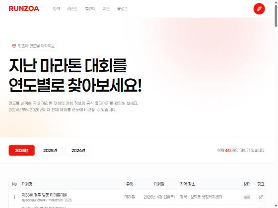

- 목적: 지난 대회를 연도별로 조회
- 구성: 연도 탭(2026·2025·2024), "현재 N개의 대회가 있습니다" 문구(2026 선택 시 442개 표기, 연도별 건수가 아니라 전체 건수일 수 있음, 미확인), 표(No, 대회명+slug, 유형, 대회일, 지역·장소, 상태, 외부 링크 아이콘), 페이지네이션(이전·1~5·다음)
- 동작: 연도 탭 전환, 페이지 이동, 링크 아이콘으로 공식 홈페이지 이동
- 상태: 지난 대회는 "종료" 뱃지
- 관련 요구사항: FR-027

## SCR-016 주소 좌표 변환 (`/geocoder`)

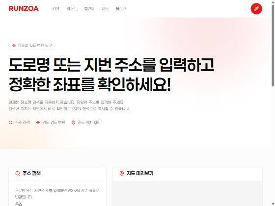

- 목적: 운영자·개발자용 도구. 도로명·지번 주소를 WGS84 위도·경도로 변환
- 구성: 주소 입력 + [좌표 변환], 변환 결과(JSON 복사), 지도 미리보기
- 제약: 장소명 검색은 지원하지 않음(안내 문구). 변환 요청은 실행하지 않음
- 관찰: 이 도구로 얻은 좌표를 대회 데이터(위도·경도)에 입력하는 운영 흐름으로 보임(추정)
- 관련 요구사항: FR-028

## SCR-017 내 캘린더에 추가 (`/calendar-add`)

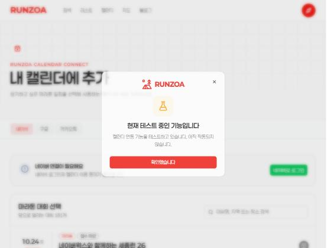

- 목적: 대회 일정을 외부 캘린더에 추가
- 구성: 캘린더 종류 탭(네이버·구글·카카오톡), "네이버 연결이 필요해요" 안내와 [네이버로 로그인], 대회 선택 목록(검색 포함, 카드마다 "캘린더에 추가" 버튼)
- 상태: 진입 즉시 모달로 "현재 테스트 중인 기능이며 아직 작동하지 않습니다" 안내. 즉 베타 기능
- 인증: 네이버 OAuth 시작 경로(`/auth/naver/start?next=...`) 확인. robots.txt가 `/auth/`를 금지하므로 로그인은 시도하지 않음
- 관련 요구사항: FR-015, FR-029

## SCR-018 사이트 통계 (`/analytics`)

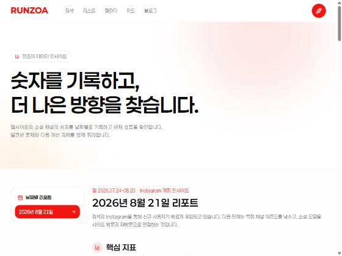

- 목적: 운영자가 웹·Instagram 성과를 공개 리포트로 기록
- 구성: 날짜별 리포트 선택, 핵심 지표(웹 활성 사용자, 평균 참여 시간, Instagram 조회·도달·반응·프로필 방문·링크 클릭), 유입 채널, 발견→방문 흐름, 관찰된 흐름, 문제점, 개선 제안 5건, 주요 콘텐츠, 데이터 출처 탭 3개(Google Analytics, Instagram 조회, Instagram 반응·팔로워)
- 관련 요구사항: FR-030
