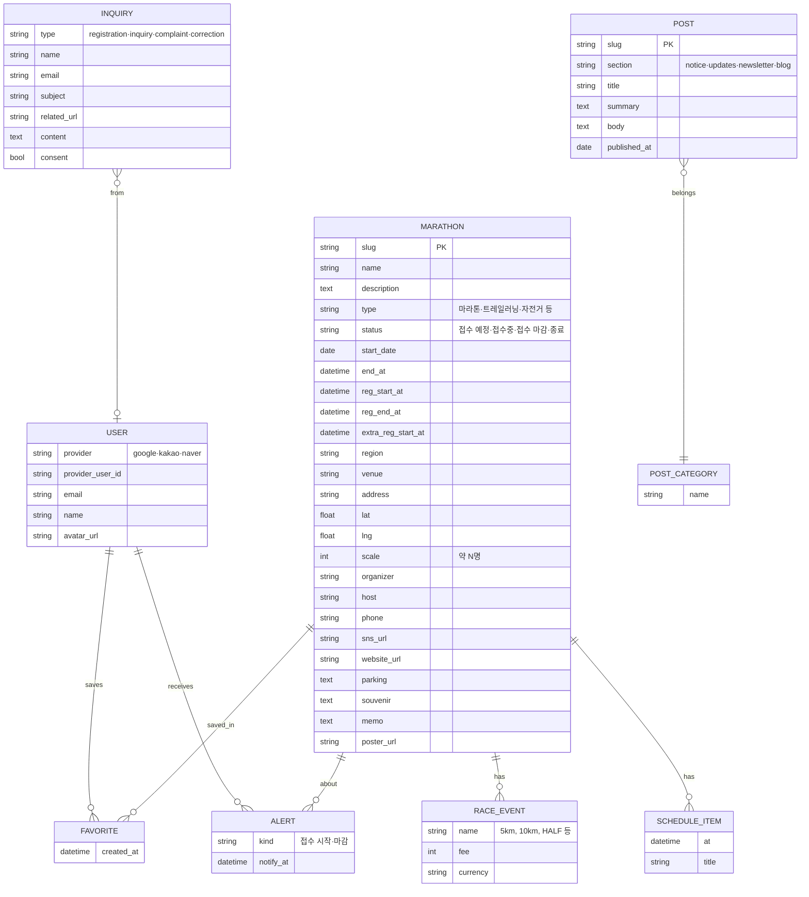

# API 및 데이터 모델 추정 (런조아)

화면에서 관찰한 필드로 추정한 구조입니다. 서버 코드나 DB를 본 것이 아니므로 모두 **(추정)**입니다.

## 1. API 관찰 결과

- 목록, 달력, 지도, 상세 데이터는 별도 REST/XHR 호출이 보이지 않았습니다. Next.js 서버 렌더링(RSC)으로 내려오는 것으로 보입니다. 이동 시 `?_rsc=` 요청만 확인했습니다.
- 클라이언트에서 확인한 외부 호출은 Google Analytics뿐입니다.
- 인증 경로로 `/auth/naver/start?next={경로}`를 확인했습니다. `/auth/`는 robots.txt 금지라 호출하지 않았습니다.
- 문의 폼의 제출 대상은 확인하지 못했습니다(제출하지 않음).
- 결론: 공개 JSON API는 관찰되지 않았습니다. 제작자는 별도 API 서비스(Apizoa)를 운영한다고 소개하지만, 이 서비스가 그것을 쓰는지는 알 수 없습니다.

## 2. URL 규칙

| 경로 | 파라미터 |
| --- | --- |
| `/marathon-list` | `status=open|upcoming` |
| `/marathon-calendar` | `month=YYYY-MM` |
| `/marathon/{slug}` | slug는 `대회명-연도` 형태의 영문 식별자 |
| `/new` | `type=notice|updates` |
| `/support` | `type=registration|inquiry|complaint|correction` |
| `/blog/{slug}`, `/new/{slug}` | 글 slug |

## 3. 추정 ERD

근거: 대회 상세와 카드의 필드(SCR-003, 006), 개인정보처리방침 제2조의 처리 항목(소셜 로그인 식별값, 관심 대회, 저장한 일정, 설정), 문의 폼 필드(SCR-010).

## 4. 파생 값 계산 규칙 (관찰)

| 값 | 관찰된 규칙 |
| --- | --- |
| D-day | 개최일 기준. 접수 마감은 별도로 "오늘 마감", "마감 D-N" 표기 |
| 접수 상태 | 접수 시작일 전: 접수 예정, 기간 중: 접수중, 마감 이후: 접수 마감, 개최일 이후: 종료(아카이브) |
| 추가 접수 | 접수가 끝난 뒤 "추가 접수 시작" 일시를 따로 갖는 대회가 있음 |
| 규모 | 숫자 대신 "규모 확인"으로 표기되는 대회가 있음(값 없음) |
| 참가비 | 종목별 가격에서 최소~최대 범위를 계산. 해외 대회는 통화가 다름(엔화) |
| 취소 | 대회명에 "(취소)"를 붙여 달력에 남김 |

## 5. TogeRun 설계에 주는 점

- 접수 오픈일, 마감일, 대회일을 별도 필드로 가진다는 점이 PRD의 FR-04와 일치합니다. 추가 접수 일시까지 필요할 수 있습니다.
- 규모, 참가비처럼 값이 없는 경우를 허용해야 합니다.
- 상태는 날짜에서 계산할 수 있지만, 취소·연기는 운영자가 직접 입력해야 합니다.
