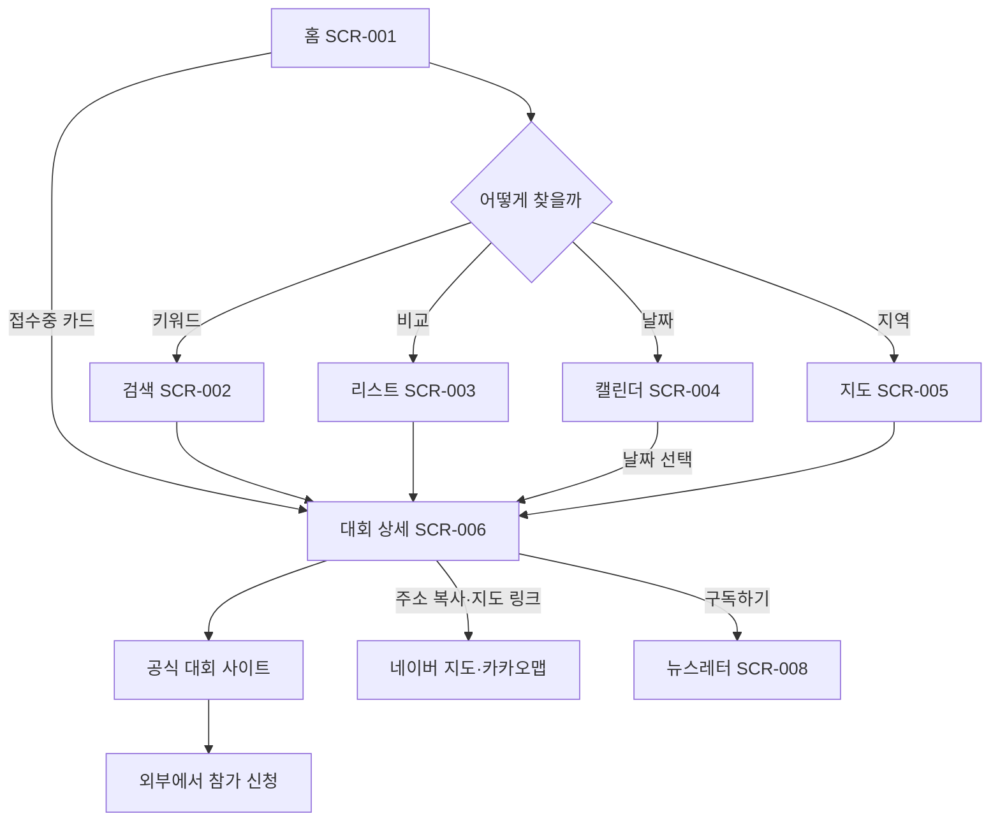
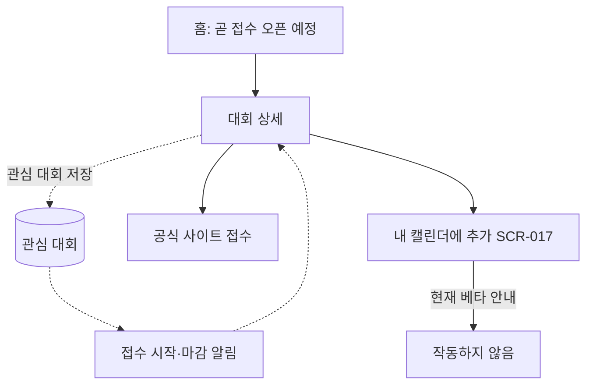
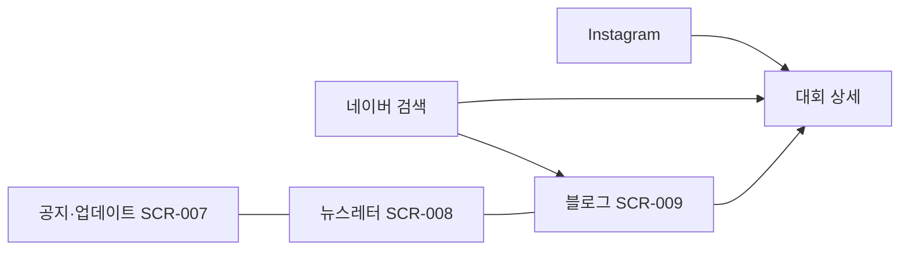

# 사용자 플로우 (런조아)

관찰한 화면 이동을 기준으로 그렸습니다. 로그인 이후 흐름은 확인하지 못해 점선과 "(추정)"으로 표시했습니다.

## 1. 대회 탐색에서 접수까지 (핵심)



## 2. 접수 시점을 놓치지 않기 (추정)



## 3. 정보 오류 제보

```mermaid
flowchart TD
  D[대회 상세에서 오류 발견] --> SUP[고객지원 SCR-010 수정요청 탭]
  SUP --> FORM[이름·이메일·제목·관련 주소·내용 작성]
  FORM --> AGREE[개인정보 동의 체크]
  AGREE --> SUB[문의하기]
  SUB -.-> OP[운영자: 공식 자료 확인 후 수정 (추정)]
  OP -.-> UP[대회 정보 갱신]
```

## 4. 콘텐츠 소비



## 5. 관찰된 흐름의 공백 (TogeRun의 기회)

- 대회 상세 이후는 모두 외부 사이트입니다. 같이 갈 사람을 찾거나 참가 의사를 남기는 경로가 없습니다.
- 알림과 캘린더 추가는 완성되지 않았거나 확인되지 않았습니다.
- 커뮤니티는 "준비 중"이라 후기와 팁은 운영자가 쓰는 블로그에 한정됩니다.
