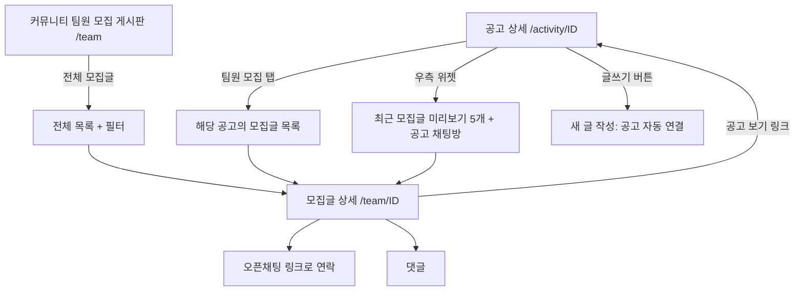

# 링커리어 팀원 모집 기능 분석

TogeRun의 동행 모집 기능을 설계하기 위한 참고 분석입니다. 대상은 링커리어(linkareer.com)의 공모전·대외활동 **팀원 모집** 구조입니다. 구조, 필드, 흐름만 정리했고 문구와 디자인은 옮기지 않았습니다. 확인한 것과 추정한 것을 구분했습니다.

- 기준일: 2026-10-21
- 분석 대상: 공고 상세 `/activity/353451`의 팀원 모집 탭, 커뮤니티 팀원 모집 게시판 `community.linkareer.com/team`, 모집글 상세 `/team/{id}`
- robots.txt: 두 도메인 모두 해당 경로 허용
- 미확인: **글쓰기 폼.** 로그인이 필요해 열어 보지 못했습니다(로그인과 폼 제출은 하지 않음). 글쓰기 필드는 모집글 상세 화면에 보이는 항목으로 추정했습니다.
- 스크린샷: [LK-01](screenshots/LK-01_activity_detail.jpg), [LK-02](screenshots/LK-02_activity_team_tab.jpg), [LK-03](screenshots/LK-03_team_board.jpg), [LK-04](screenshots/LK-04_team_post_detail.jpg), [LK-05](screenshots/LK-05_filter_type.jpg)

## 1. 한눈에 보는 구조

모집 기능이 **두 곳에서 같은 데이터**를 보여 줍니다.



핵심 아이디어는 **모집글이 반드시 특정 공고(공모전)에 연결**된다는 점입니다. 글을 공고 화면에서 쓰면 공고가 자동으로 붙고(`activityId` 파라미터), 커뮤니티에서 쓰면 공고를 고르는 구조로 보입니다(추정).

## 2. 화면별 구성

### 2-1. 공고 상세의 팀원 모집 탭 (LK-02)

| 요소 | 내용 |
| --- | --- |
| 진입 | 공고 상단의 [팀원 모집글 보기] 버튼, 또는 탭(상세내용 / 팀원 모집(N) / 합격자료 / 담당자 Q&A) |
| 탭 뱃지 | 모집글 수(25)와 NEW 표시 |
| 헤더 | "팀원 모집 N" 제목, 안내 문구(팀원을 모아 공고에 지원), [모집중인 게시글만 보기] 체크박스, [팀원 모집 글쓰기] 버튼 |
| 목록 행 | 상태 뱃지(모집중/마감), 지역, 제목, 조회수, 댓글 수, 등록일 |
| 페이징 | 번호 페이지(1·2·3) |

### 2-2. 공고 상세의 우측 위젯 (LK-01)

- 팀원 모집 미리보기: 최근 글 5개를 카드로 노출. 작성자는 **자동 생성된 익명 닉네임**(형용사+명사 조합), 지역, 제목, 작성 시각(시:분), [모집글 보러 가기]
- 공고별 채팅방: 참여 인원 수(355명)와 [채팅방 참여하기]
- 상단 정보: 스크랩 수(303), 스크랩한 사용자 보기, 조회수·댓글 수

### 2-3. 커뮤니티 팀원 모집 게시판 (LK-03, LK-05)

- 좌측: 게시판 메뉴, 로그인 유도 카드
- 상단: 게시판 이름 `대외활동/공모전 팀원모집`, [글쓰기]
- **필터 4종 + 검색**

| 필터 | 선택지(확인) |
| --- | --- |
| 모집 종류 | 전체 · 대외활동 · 공모전 |
| 모집 여부 | 전체 · 모집중 · 마감 |
| 지역 | 전체 · 지역 무관 · 온라인 · 서울 · 부산 · 인천 · 대구 · …(시·도 목록) |
| 성별 | 전체 · 성별 무관 · 남자 · 여자 |
| 검색 | 기업명·공고명·제목 중심 검색(안내 문구 기준) |

- 목록 컬럼: 번호, 제목, 글쓴이, 등록일, 조회, 추천, 스크랩. 한 행의 제목 영역에 **공고명, 지역, 모집 상태, 글 제목, 직무 태그**(예: 백엔드개발, 기획/디자인)가 함께 보임
- 운영 공지가 목록 상단에 고정되고, 오늘 등록된 글은 날짜 대신 시각 표시

### 2-4. 모집글 상세 (LK-04)

상단 요약(뱃지 줄): `[모집중] 공고명 | 지역`

| 영역 | 항목 |
| --- | --- |
| 제목 줄 | 제목, 작성자(닉네임), 등록 일시, 조회·추천·스크랩, 주소복사, 더보기(⋮) 메뉴 |
| **모집 정보 표** | **종류**(공모전/대외활동), **공고**(링크 + [공고 보기]), **모집 마감일**, **지역**, **모집 인원**, **성별**(무관/남/여) |
| 본문 | 자유 텍스트. 관찰한 글들은 대체로 "원하는 사람(자격)", "팀 활동 방향", "연락 방법(오픈채팅 링크)" 순서로 작성 |
| 반응 | 추천·비추천 버튼, 베스트로 올려 달라는 유도 문구 |
| 하단 | [목록], 댓글 입력(등록, 사진 첨부), 같은 게시판 목록 |

## 3. 모집글 데이터 구조 (추정)

| 필드 | 타입 | 필수(추정) | 근거 |
| --- | --- | --- | --- |
| 모집 종류 | 선택(공모전/대외활동) | 필수 | 상세 표, 필터 |
| 공고(연결 대상) | 공고 ID | 필수 | 상세 표, 글쓰기 URL의 `activityId` |
| 모집 마감일 | 날짜 | 필수 | 상세 표 |
| 지역 | 선택(지역 무관, 온라인, 시·도) | 필수 | 상세 표, 필터 |
| 모집 인원 | 숫자 | 필수 | 상세 표 |
| 성별 | 선택(무관/남/여) | 필수 | 상세 표, 필터 |
| 직무·역할 태그 | 선택 | 선택 | 목록 행의 태그 |
| 제목 | 텍스트 | 필수 | - |
| 본문 | 텍스트(이미지 가능) | 필수 | 댓글 영역의 사진 버튼으로 보아 이미지 업로드 지원 |
| 모집 상태 | 모집중/마감 | 자동+수동(추정) | 마감일 지나면 마감, 작성자가 직접 마감도 가능해 보임 |
| 연락 방법 | 본문에 오픈채팅 링크를 직접 기재 | 선택 | 관찰한 글에서 확인. 별도 필드는 아님 |

연락은 **자체 채팅이 아니라 외부 오픈채팅 링크**를 본문에 적는 방식입니다. 다만 링커리어는 공고별 자체 채팅방도 따로 운영합니다.

## 4. 주요 동작과 규칙

- 모집글 읽기는 **로그인 없이** 가능. 글쓰기는 로그인 필요(로그인 페이지로 이동하고 돌아올 주소 `next`를 유지)
- 상태: 모집중/마감. 목록에서 마감 글은 회색 뱃지, 모집중 글만 보는 필터 제공
- 반응: 추천, 비추천, 스크랩, 댓글
- 운영: 상단 공지로 이용 주의사항과 "무통보 삭제 기준", 운영정책을 고정
- 신고: 더보기(⋮) 메뉴가 있으나 항목은 확인하지 못함(미확인)
- 개인정보: 닉네임은 자동 생성된 익명 이름. 실명은 노출되지 않음

## 5. 강점과 약점

| 구분 | 내용 |
| --- | --- |
| 강점 | 모집글이 공고에 **강제로 연결**되어, 공고를 보다가 바로 팀을 찾고 쓸 수 있음 |
| 강점 | 모집 정보를 표(종류·마감일·지역·인원·성별)로 정형화해 글을 열지 않아도 요건을 파악 |
| 강점 | 공고 화면 한 곳에서 목록, 미리보기, 글쓰기, 채팅방이 모두 연결 |
| 강점 | 로그인 없이 열람 가능해 유입과 SEO에 유리 |
| 약점 | 본문이 자유 형식이라 글마다 품질 편차가 큼(자격·방향·연락을 안 쓰는 글도 있음) |
| 약점 | 마감 처리가 약해 보임: 마감된 글이 목록의 대다수(첫 화면 10건 중 8건이 마감) |
| 약점 | 연락이 본문 링크라 신고·차단·스팸 대응이 약함(확인 한도 내 추정) |
| 약점 | 조회수 대비 댓글이 거의 없음(댓글 0~1). 연락이 외부로 빠져 서비스 안에서는 반응이 안 보임 |

## 6. TogeRun 적용안

### 6-1. 구조 매핑

| 링커리어 | TogeRun |
| --- | --- |
| 공고(공모전) | 대회 |
| 공고 상세 안의 팀원 모집 탭 | 대회 상세 안의 모집글 목록(PRD FR-08, FR-09) |
| 커뮤니티 전체 팀원 모집 게시판 | 모집글 전체 목록(PRD FR-10) |
| 공고 우측 최근 모집글 미리보기 | 대회 상세의 "모집 중인 동행" 요약 |
| 공고별 채팅방 | 제외(자체 채팅은 PRD 2차) |

### 6-2. 모집글 양식 비교

| 항목 | 링커리어 | TogeRun PRD | 제안 |
| --- | --- | --- | --- |
| 대상 연결 | 공고 필수 | 대회 자동 연결 | **채택** |
| 종류 | 공모전/대외활동 | 종목(5K·10K·하프·풀) | 종목으로 대체 |
| 모집 인원 | 숫자 | 숫자 | 채택 |
| 지역 | 지역 무관·온라인·시도 | 출발 지역 | 채택(출발 지역으로 의미 변경) |
| 모집 마감일 | 날짜 | 없음 | **추가 검토.** 대회 접수 마감 전까지로 자동 설정하고 수정 가능하게 |
| 성별 | 무관/남/여 | 없음 | **도입하지 않는 쪽을 권장** (아래 6-3) |
| 직무 태그 | 있음 | 동행 방식 | 동행 방식(현장 합류·같이 이동·페이스 맞춰 완주)으로 대체 |
| 연락 | 본문에 링크 | 오픈채팅 링크 전용 입력 | **TogeRun 방식이 더 나음.** 별도 필드로 링크 형식 검사 |
| 자유 본문 | 필수 | 한 줄 소개(선택) | 한 줄 소개 유지. 자유 본문은 짧게 제한 |

### 6-3. 따라 하지 않는 편이 좋은 부분

- **성별 필터:** 링커리어는 팀 프로젝트 모집이지만, TogeRun은 처음 보는 사람과 현장에서 만나는 서비스라 성별로 모집을 거르면 안전·차별 이슈가 커집니다. 필요하면 "같이 뛰고 싶은 사람 유형"을 자유 태그로 받는 쪽이 낫습니다(결정이 필요한 항목).
- **마감 방치:** 마감 글이 목록을 채우지 않도록 기본 필터를 "모집중"으로 두고, 대회일이 지나면 자동 마감합니다. PRD의 마감 처리(US-06)와 연결됩니다.
- **자유 형식 본문:** 글 품질이 들쭉날쭉해지므로 선택형 항목 중심으로 구성합니다(PRD의 뱃지 요약 방식 유지).
- **신고 약함:** 링커리어는 신고 진입점이 약해 보입니다. TogeRun은 글과 사용자 신고·차단을 처음부터 넣습니다(PRD FR-12).

### 6-4. 그대로 가져올 만한 패턴

1. 대회 상세 안에서 모집글을 보고 쓰는 흐름(목록 → 글쓰기에 대회 자동 연결)
2. 목록 행에 상태 뱃지·지역·제목을 한 줄로 요약
3. 상세 상단의 모집 정보 표(종목·동행 방식·인원·출발 지역·모집 마감일)
4. 로그인 없이 열람, 쓰기·연락 시에만 로그인 요구
5. 로그인 뒤 원래 화면으로 돌아오는 `next` 처리
6. 자동 생성 익명 닉네임(PRD의 "익명 닉네임" 요구와 일치)
7. 상단 고정 운영 공지(PRD의 "운영 규칙을 모집방 상단에 고정")
8. 모집중 글만 보기 필터와 탭의 모집 글 수 뱃지

## 7. 화면 설계 초안 (TogeRun)

대회 상세의 모집 영역을 링커리어 구조에 맞춰 이렇게 잡을 수 있습니다.

```text
[대회 상세]
 ├ 대회 정보 / 날짜 3종(접수 오픈·접수 마감·대회일)
 ├ 같이 뛸 사람 (모집중 N건) ──── [모집글 쓰기]
 │    ├ 필터: 종목 · 동행 방식 · 출발 지역 · [모집중만]
 │    └ 카드: [하프] [현장 합류] [수원]  한 줄 소개  모집 2/3  D-5
 └ 안전 안내(상단 고정 운영 규칙)

[모집글 상세]
 ├ 요약 표: 대회 · 종목 · 동행 방식 · 모집 인원 · 출발 지역 · 모집 마감일
 ├ 목표 기록·페이스 / 한 줄 소개
 ├ [오픈채팅으로 연락하기]
 └ 신고 · 차단
```

## 8. 한계

- 글쓰기 폼과 글 수정·삭제, 마감 처리 방식은 로그인이 필요해 확인하지 못했습니다.
- 신고 메뉴의 실제 항목, 비추천·스크랩 동작은 확인하지 않았습니다.
- 링커리어는 대학생 공모전 팀 구성이 목적이라 러닝 동행과 목적이 다릅니다. 필드를 그대로 옮기기보다 구조만 참고하세요.
- 목록 규모(공고 하나에 25건, 게시판 번호 약 7,700번)는 링커리어의 이용 규모를 가늠하는 참고치일 뿐입니다.
