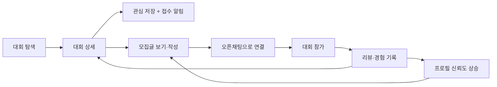

# TogeRun 기획 개요

[PRD](../PRD.md)를 바탕으로, 런조아와 링커리어 분석([docs/analysis](../analysis/))에서 얻은 근거를 더해 기획을 구체화한 문서입니다. 서비스명은 가칭입니다. 숫자 목표처럼 아직 정해지지 않은 값은 "(제안)" 또는 "미정"으로 표시했습니다.

## 1. 한 줄 정의

혼자 신청하기 망설여지는 마라톤 대회에, **같이 뛸 사람을 대회 페이지 안에서 바로 찾는** 동행 서비스.

## 2. 해결할 문제

| 문제 | 지금 러너가 하는 일 | 불편 |
| --- | --- | --- |
| 대회는 찾았는데 같이 갈 사람이 없다 | 대회 정보 사이트에서 대회를 고르고, 동행은 SNS나 오픈채팅에서 따로 찾는다 | 두 곳을 오가야 하고, 어느 대회 얘기인지 흩어져 있다 |
| 접수 시작을 놓친다 | 대회 공식 사이트와 SNS를 수시로 확인한다 | 인기 대회는 접수 시작 후 금방 마감된다 |
| 대회 후기가 흩어져 있다 | 블로그, 카페, SNS를 뒤진다 | 코스·운영·접근성 같은 같은 기준으로 비교하기 어렵다 |
| 모르는 사람과 만나는 게 불안하다 | 오픈채팅 방에서 불특정 다수와 이야기한다 | 신원 노출 부담, 신고할 곳이 마땅치 않다 |

## 3. 타깃과 시나리오

| 구분 | 설명 | 대표 시나리오 |
| --- | --- | --- |
| 주 사용자: 혼자 나가는 러너 | 대회에 나가고 싶지만 동행이 없다 | 관심 대회를 저장하고, 그 대회의 모집글을 찾아 연락한다 |
| 주 사용자: 모집하는 러너 | 같이 갈 사람을 구하고 싶다 | 대회 상세에서 모집글을 올리고, 인원이 차면 마감한다 |
| 보조 사용자: 정보 탐색 러너 | 동행보다 대회 정보와 후기가 필요하다 | 대회를 필터로 찾고 리뷰를 읽는다. 로그인 없이도 가능 |
| 운영자 | 대회 정보와 신고를 관리한다 | 제보를 확인해 대회 정보를 고치고, 신고된 글을 처리한다 |

## 4. 가치 제안과 차별점

레퍼런스 분석에서 확인한 빈칸을 중심으로 정리했습니다.

| 기능 | 런조아 | 링커리어(팀원 모집) | TogeRun |
| --- | --- | --- | --- |
| 대회 정보·접수 일정 | 있음 | 해당 없음 | 있음 |
| 대회에 연결된 팀·동행 모집 | **없음** | 공고에 연결된 모집 탭 | 대회 상세 안의 모집 |
| 접수 알림 | 소개만 있고 화면 미확인 | 해당 없음 | 핵심 기능 |
| 대회별 리뷰 | 없음(운영자 블로그만) | 해당 없음 | 대회별 리뷰 |
| 대회별 커뮤니티 | "준비 중" | 전체 게시판 중심 | 대회마다 별도 |
| 모집 요건 정형화 | 해당 없음 | 표로 정형화 | 종목·동행 방식 등 선택형 |
| 만남의 안전 장치 | 해당 없음 | 신고 진입점 약함 | 신고·차단·익명 닉네임·운영 규칙 고정 |
| 접수 처리 | 공식 사이트로 연결 | 해당 없음 | 공식 사이트로 연결(직접 중개하지 않음) |

TogeRun의 차별점은 세 가지입니다.

1. **대회가 중심 단위다.** 모집, 리뷰, 커뮤니티가 모두 대회에 붙는다.
2. **판단에 필요한 정보를 글 밖에서 알려 준다.** 종목·동행 방식·출발 지역 뱃지와 공개 프로필(페이스, 경험)로 글을 열기 전에 맞는지 가늠한다.
3. **가볍지만 안전하다.** 연락은 오픈채팅 링크로만 하고, 실명과 연락처는 공개하지 않는다.

## 5. 핵심 사용 흐름(루프)

대회 참가 후 남긴 리뷰와 경험 기록이 다시 다음 사람의 대회 선택과 모집글 신뢰도로 돌아오는 구조를 만드는 것이 핵심입니다.

## 6. 범위

[PRD](../PRD.md)의 우선순위를 그대로 따릅니다.

| 단계 | 기능 |
| --- | --- |
| MVP | 대회 목록·필터·캘린더·상세(세 가지 날짜), 관심 저장·접수 알림·캘린더 추가, 모집글(작성·목록·마감·오픈채팅 연결), 대회별 리뷰, 대회별 커뮤니티, 회원 러닝 프로필과 경험 기록, 신고·차단, 정보 오류 제보·등록 문의, 운영자 관리 |
| 2차 | 동행 후 후기·매너 평가, 자체 채팅, 리뷰·커뮤니티 사진 첨부 |
| 3차 | 지역·종목·페이스 기반 추천 |
| 이번에 하지 않는 것 | 참가 신청·결제 중개, 지도 화면, 블로그·뉴스레터 운영 |

MVP 범위가 넓어서 출시 순서를 나눌 것을 제안합니다(제안, 확정 아님).

| 순서 | 묶음 | 이유 |
| --- | --- | --- |
| 1 | 대회 정보 + 상세 + 관심 저장·알림 | 모든 기능의 바탕이고 대회 데이터가 있어야 나머지가 의미를 가짐 |
| 2 | 모집글 + 프로필 + 신고·차단 | 서비스의 존재 이유. 안전 장치는 모집과 함께 나가야 함 |
| 3 | 리뷰 + 커뮤니티 | 이용자가 쌓여야 글이 생김. 대회일 이후에야 쓸 수 있는 리뷰는 나중에 열어도 늦지 않음 |

## 7. 성공 지표 (제안)

목표 수치는 서비스 규모를 모르는 상태라 정하지 않았습니다. 측정 항목만 제안합니다.

| 단계 | 지표 | 의미 |
| --- | --- | --- |
| 유입 | 대회 상세 조회 수, 로그인 없이 읽는 비율 | 정보만으로 올 만한 이유가 있는가 |
| 활성 | 관심 대회 저장 수, 알림 설정 비율 | 재방문 장치가 작동하는가 |
| 핵심 | 대회당 모집글 수, 모집글 작성자 대비 연락 클릭 비율 | 동행 매칭이 일어나는가 |
| 성사 | 모집 완료 처리 비율(마감 처리된 글 / 전체 글) | 모집이 끝까지 가는가 |
| 선순환 | 참가 후 리뷰·경험 기록 작성 비율 | 참가가 다음 사람의 정보로 돌아오는가 |
| 안전 | 신고 건수 대비 처리 시간, 차단 수 | 안전하게 운영되는가 |

런조아의 공개 통계에서 네이버 검색 유입이 약 72%이고 재방문 지표가 약하다고 스스로 진단한 점은 참고할 만합니다. 검색 유입에 의존하지 않고 알림과 저장으로 재방문을 만드는 것이 TogeRun의 지표 설계 방향입니다.

## 8. 리스크와 대응

| 리스크 | 영향 | 대응 방향 |
| --- | --- | --- |
| 콜드 스타트: 모집글·리뷰가 없는 대회 페이지는 비어 보인다 | 첫 방문 이탈 | 대회 정보와 접수 알림만으로도 가치가 있게 만들고, 인기 대회부터 모집을 유도 |
| 낯선 사람 간 만남의 안전 | 신뢰 하락, 법적 부담 | 익명 닉네임, 신고·차단, 운영 규칙 고정, 연락처 비공개 |
| 대회 데이터 확보와 정확성 | 알림 오작동, 신뢰 하락 | 공식 출처 기준 수집과 출처 기록, 오류 제보 흐름, 운영자 입력 도구 |
| 저작권: 대회 포스터·타 서비스 문구 | 분쟁 | 텍스트 정보 중심, 이미지는 직접 확보한 것만 사용, 권리자 요청 시 삭제 |
| 운영 부담: 모집글·리뷰·커뮤니티 모두 신고 대상 | 대응 지연 | 신고 처리 흐름과 자동 숨김 기준을 정하고, 출시를 단계별로 나눔 |
| 개인정보: 성별·나이 수집 | 법적·신뢰 문제 | 선택 입력, 기본 비공개, 수집 동의, 필터로 쓰지 않음 |
| 경쟁: 런조아가 커뮤니티를 "준비 중"으로 두고 있음 | 같은 영역 진입 가능 | 대회 단위 동행 모집과 안전 장치의 완성도로 앞서기 |

## 9. 정해야 할 것

[PRD](../PRD.md)의 열린 질문을 그대로 따르고, 기획 단계에서 추가로 보이는 항목을 더했습니다.

- 로그인 수단, 알림 채널과 시점, 당첨 발표일 알림 여부
- 대회 종료 후 모집방·커뮤니티 처리, 회차별 분리 여부
- 리뷰 참가 인증 여부, 자동 숨김 기준, 나이 입력 방식과 미성년 처리, 수집 동의 문구
- 추가: 대회 데이터를 어떻게 채울지(직접 입력, 공식 출처 수집, 제휴·공개 데이터). 런조아 데이터를 그대로 가져오지 않는다는 방침은 이미 정했고, 그다음 방법이 정해지지 않았습니다.
- 추가: 출시 순서(6장의 제안) 확정
