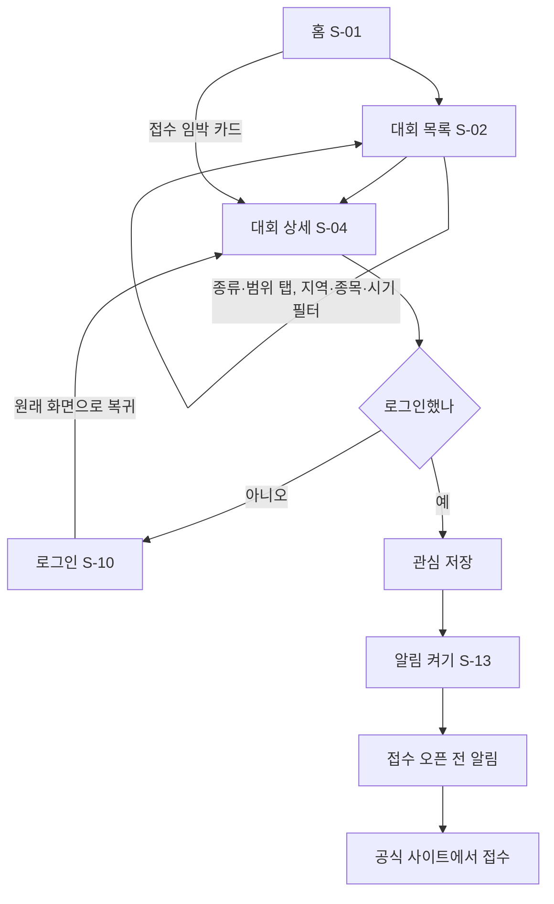
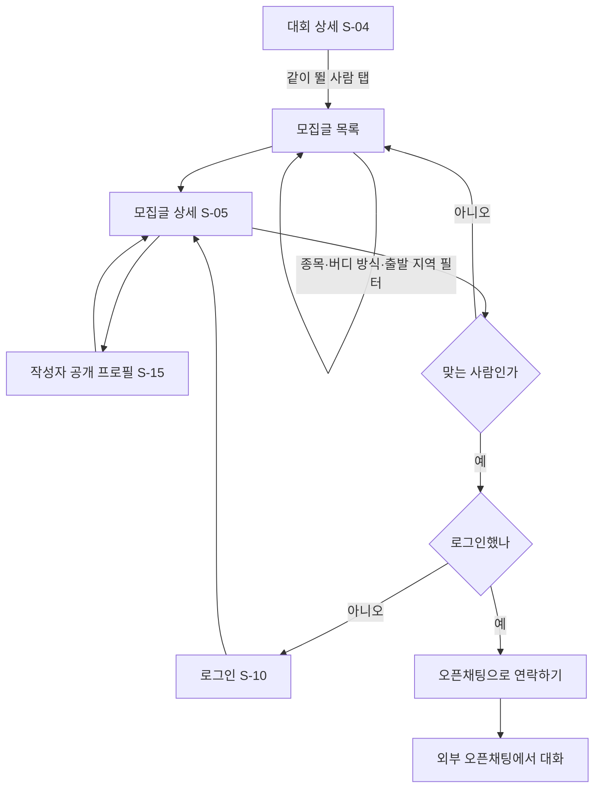
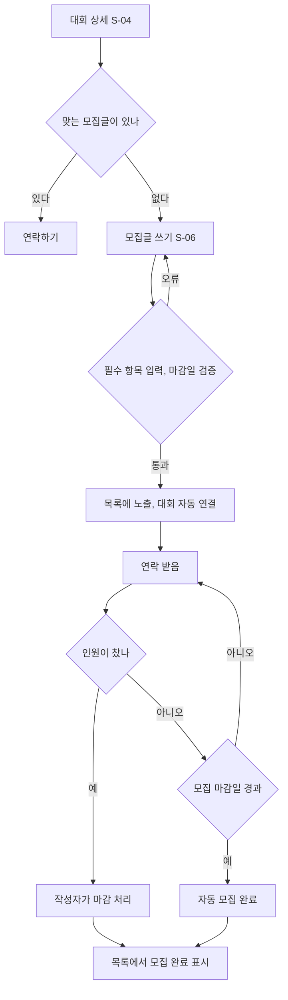
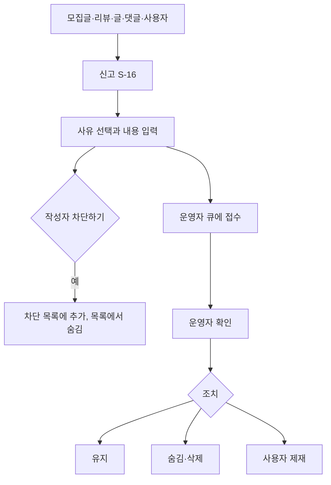
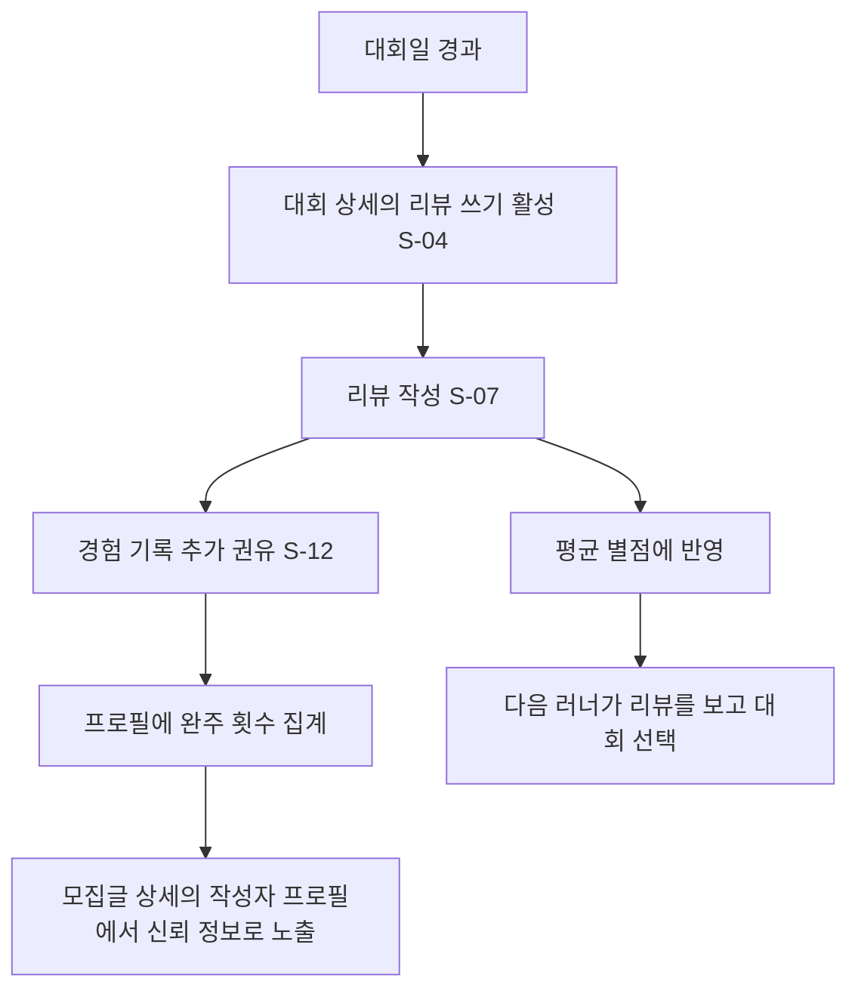
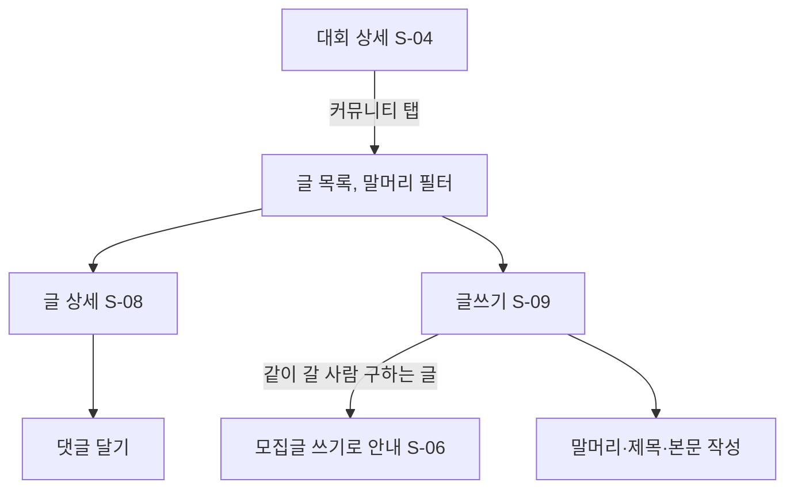
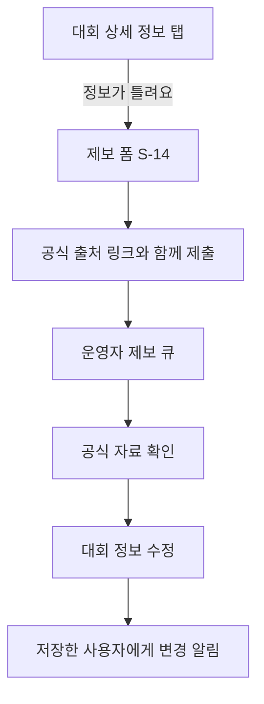
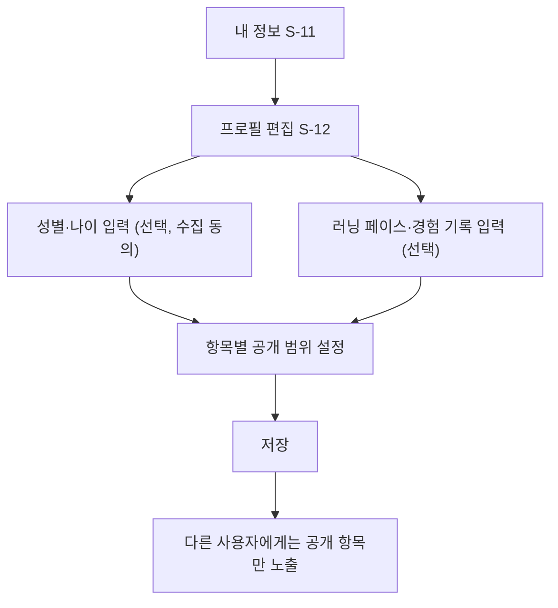
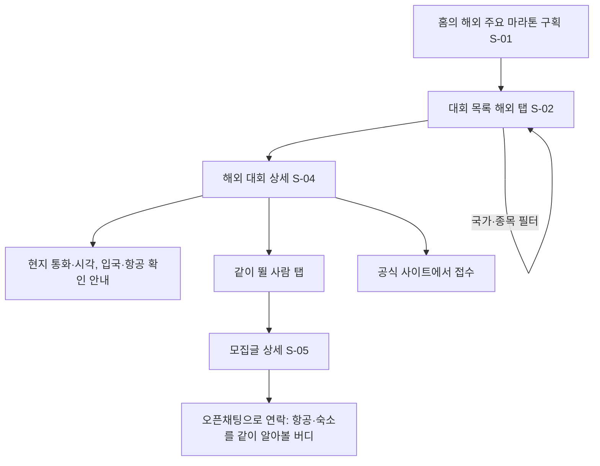

# 사용자 플로우

[PRD](../PRD.md)의 사용자 스토리(US-01~14)를 흐름으로 옮겼습니다. 화면ID는 [02_정보구조_및_화면목록.md](02_정보구조_및_화면목록.md)를 따릅니다.

## 1. 대회를 찾아 접수 알림 받기 (US-01, US-02)

## 2. 같이 뛸 사람 찾아 연락하기 (US-03, US-04, US-14)

## 3. 모집글 올리고 마감하기 (US-05, US-06)

## 4. 신고·차단 (US-07, US-12)

## 5. 대회 참가 후 리뷰와 경험 기록 (US-09, US-10, US-13)

## 6. 대회별 커뮤니티 (US-11)

## 7. 정보 오류 제보 (US-08)

## 8. 프로필 공개 범위 설정 (US-13)

## 9. 해외 대회에서 버디 찾기 (US-15, US-16)

