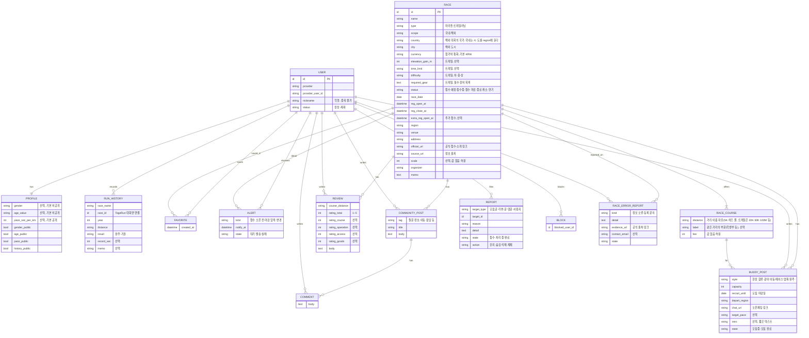

# 데이터 모델 (개념 수준)

기획 단계의 개념 모델입니다. 기술 선택과 상세 스키마는 다음 문서(SDD)에서 다룹니다. 필드는 [PRD](../PRD.md)의 양식과 화면명세서에서 가져왔고, 레퍼런스에서 가져온 구조는 근거를 달았습니다.

## 1. ERD

## 2. 설계 메모

| 주제 | 내용 | 근거 |
| --- | --- | --- |
| 세 가지 날짜 | 접수 오픈·접수 마감·대회일을 각각 별도 필드로 둔다. 추가 접수 일시도 선택 필드로 둔다 | PRD FR-04, 런조아가 추가 접수 일시를 따로 가짐 |
| 상태는 계산 + 수동 | 접수 예정·접수중·접수 마감·종료는 날짜로 계산하고, 취소·연기는 운영자가 직접 입력 | 런조아 상태 표기 규칙 |
| 값 없음 허용 | 참가비·규모는 비어 있을 수 있고 화면에는 "미정"으로 표시 | 런조아가 규모를 "확인 필요"로 표기 |
| 종목 | 한 대회에 종목이 여러 개이므로 별도 엔티티(RACE_COURSE)로 두고, 모집글·리뷰가 종목을 가리킨다 | 모집글 양식의 종목 필수 |
| 종류·범위 | 종류(마라톤/트레일러닝)와 범위(국내/해외)는 대회의 속성으로 두고 목록·캘린더·지도에서 탭으로 가른다 | 랭킹마라톤의 분리 방식 참고 |
| 거리 이름 | 거리를 4가지 고정값이 아니라 자유로운 이름으로 둔다. 필터 선택지는 해당 종류·범위의 대회에 있는 거리만 보여 준다 | 트레일(20K·50K·100M)과 해외 대회를 담기 위해 |
| 통화와 환산 | 참가비는 대회의 통화(currency)로 저장하고, 원화 환산은 저장하지 않고 화면에서 고정 환율로 계산한다 | 환율은 변하므로 저장 값과 분리 |
| 해외 시각 | 해외 대회의 접수·개최 시각은 현지 시각으로 저장하고 화면에 밝힌다 | 시차 혼동 방지 |
| 모집글의 연락 | 연락은 본문이 아니라 `chat_url` 별도 필드로 받고 형식을 검사 | 링커리어는 본문에 링크를 적어 신고·검증이 어려움 |
| 모집글 상태 | 마감일 경과 시 자동 모집 완료. 작성자 수동 마감도 같은 상태값 | PRD AC-08, AC-10 |
| 프로필 공개 | 항목별 공개 플래그를 따로 둔다. 기본값은 성별·나이 비공개 | PRD FR-26 |
| 리뷰 1인 1건 | (사용자, 대회) 조합이 유일하다. 대회 회차 분리 여부는 미정 | PRD 열린 질문 |
| 출처 기록 | 대회에 `source_url`을 남겨 공식 출처 기준 수집 원칙을 지킨다 | 런조아 운영정책, PRD 저작권 요구 |
| 신고 | 대상 종류와 대상 ID를 묶는 다형 구조로 모집글·리뷰·글·댓글·사용자를 한 큐로 받는다 | PRD FR-12 |
| 회차 | 같은 대회가 매년 열리므로 RACE는 한 회차를 뜻하는 것으로 두고, 시리즈로 묶는 방법은 미정 | PRD 열린 질문 |

## 3. 개인정보 처리 대상

| 데이터 | 수집 | 공개 범위 |
| --- | --- | --- |
| 소셜 로그인 식별값, 이메일(로그인 수단에 따라) | 필수 | 비공개 |
| 소셜 계정의 이름·계정 아이디·프로필 사진 | 저장·공개하지 않음 | - |
| 닉네임 | 필수 | 공개 |
| 성별, 나이 | 선택(동의) | 기본 비공개, 회원이 바꿀 수 있음 |
| 러닝 페이스, 경험 기록 | 선택 | 기본 공개, 회원이 바꿀 수 있음 |
| 오픈채팅 링크 | 모집글 작성 시 | 모집글에 공개 |
| 제보·문의의 이메일 | 선택 | 비공개(운영자만) |

실명, 전화번호, 결제 정보는 수집하지 않는다.
