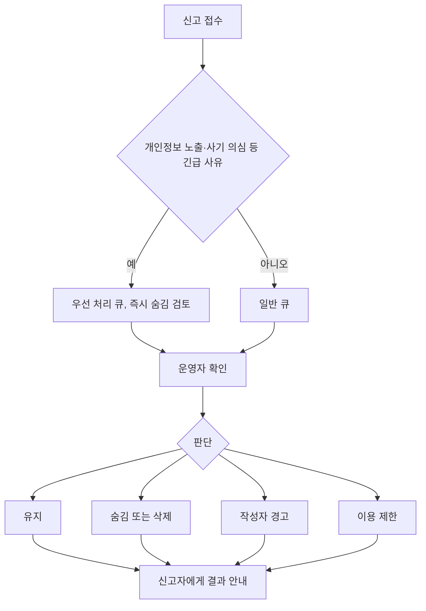

# 운영과 안전 정책 (초안)

낯선 사람이 연결되는 서비스라 안전과 운영을 기능과 같은 비중으로 설계합니다. [PRD](../PRD.md)의 안전·개인정보 요구사항을 운영 규칙으로 풀었고, 런조아의 운영정책과 링커리어의 커뮤니티 운영 방식을 참고했습니다. 문구와 수치는 초안이며 법률 검토가 필요합니다(법적 자문이 아닙니다).

## 1. 원칙

1. **대회 정보는 공식 출처를 따른다.** 출처가 충돌하면 주최 측 공식 공지를 우선한다. `[런조아]`
2. **TogeRun은 접수를 중개하지 않는다.** 참가 신청·결제·환불은 공식 사이트에서 이루어진다. `[런조아]`
3. **개인정보는 최소로 받고, 공개는 본인이 정한다.** 실명·연락처는 받지 않는다.
4. **연락은 오픈채팅 링크로만 한다.** 서비스 안에서 개인 연락처를 주고받지 않는다.
5. **신고는 쉽게, 처리는 투명하게 한다.** 모든 글에서 두 번 안에 신고할 수 있고, 처리 결과를 알린다.

## 2. 콘텐츠 규칙

| 대상 | 허용 | 금지(신고·삭제 대상) |
| --- | --- | --- |
| 모집글 | 대회 버디 모집, 선택형 조건 | 대회와 무관한 모집, 성별·나이 등 속성을 조건으로 내세우는 문구, 금전 요구, 연락처 직접 노출 |
| 리뷰 | 참가 경험에 근거한 평가 | 참가하지 않은 대회의 허위 후기, 광고·홍보, 특정인 비방, 연락처 노출 |
| 커뮤니티 글·댓글 | 대회 관련 질문, 정보, 이동·주차 팁 | 광고, 도배, 혐오·비방, 개인정보 노출, 불법 정보, 버디 구인(모집글로 안내) |
| 프로필 | 선택한 항목 | 타인 사칭, 허위 기록 신고가 접수된 내용 |
| 오픈채팅 링크 | 정상적인 오픈채팅 주소 | 외부 사이트로 유도하는 링크, 금전·사기 의심 링크 |

## 3. 신고 처리

미정 항목: 몇 건의 신고가 쌓이면 자동으로 숨길지, 처리 목표 시간, 이용 제한 기간. 모두 운영하면서 정한다.

| 조치 | 설명 |
| --- | --- |
| 유지 | 위반이 아님 |
| 숨김 | 작성자에게만 보이게 하고 사유 안내. 되살릴 수 있음 |
| 삭제 | 위반이 명확한 경우 |
| 경고 | 첫 위반이거나 경미한 경우 |
| 이용 제한 | 반복 위반이나 중대한 위반. 기간과 범위는 단계별로 정한다 |

## 4. 차단

- 사용자는 모집글·리뷰·커뮤니티 글에서 작성자를 차단할 수 있다.
- 차단하면 그 사용자의 글과 댓글이 목록에서 숨겨지고, 차단 목록은 내 정보에서 관리한다.
- 차단은 상대에게 알리지 않는다(제안).

## 5. 모집글 안전 장치

- 대회 모집방 상단에 운영 규칙을 고정한다(PRD 안전 요구). 포함할 내용: 처음 만날 때는 사람이 많은 장소를 고르기, 개인정보를 먼저 주지 않기, 금전 요구에는 응하지 않고 신고하기.
- 모집글 상세에는 항상 신고·차단 버튼을 둔다.
- 오픈채팅 연락 버튼은 로그인한 사용자에게만 보여 줄지 정한다(제안: 로그인 필요).

## 6. 개인정보

| 항목 | 방침(초안) |
| --- | --- |
| 수집 항목 | 로그인 식별값, 닉네임, 선택한 프로필 항목, 제보·문의 이메일(선택) |
| 성별·나이 | 선택 입력, 수집 목적 안내와 동의, 기본 비공개, 모집 필터로 쓰지 않음 |
| 보관 | 계정 삭제 시까지, 문의·제보는 처리 완료 후 일정 기간(기간 미정) |
| 삭제 | 회원은 언제든지 계정과 프로필·경험 기록 삭제를 요청할 수 있다 |
| 쿠키 | 로그인 유지와 서비스 개선 목적에 한해 사용 |
| 미성년자 | 나이 입력 방식과 연령 제한은 미정(PRD 열린 질문) |

## 7. 저작권과 데이터

- 대회 정보는 공식 출처에서 직접 수집하고 `source_url`을 남긴다.
- 대회 공식 이미지·포스터는 쓰지 않거나, 사용 시 권리자 확인을 거친다. 권리자 요청이 오면 지체 없이 내린다. `[런조아 운영정책 참고]`
- 타 서비스의 문구·디자인·데이터는 가져오지 않는다. 런조아의 대회 데이터를 그대로 사용하지 않는다. 약관상 허용 범위도 확인하지 않았으므로 별도로 판단한다.
- 사용자가 쓴 리뷰와 글의 저작권은 작성자에게 있고, 서비스 안에서 노출하는 범위의 이용을 약관에 정한다(약관 초안 필요).

## 8. 운영자 업무

| 업무 | 도구 | 빈도(제안) |
| --- | --- | --- |
| 대회 정보 입력·갱신 | 운영자 콘솔(S-17) | 수시, 접수 일정 변경 확인은 주기적으로 |
| 제보 처리 | 제보 큐 | 접수 시 확인 |
| 신고 처리 | 신고 큐 | 접수 시 확인, 긴급 사유 우선 |
| 취소·연기 반영 | 대회 상태 수동 변경 + 저장자 알림 | 확인 즉시 |
| 운영 규칙 갱신 | 고정 공지 | 필요 시 |

주소를 좌표로 바꾸는 입력 보조 도구는 런조아의 좌표 변환 도구를 참고할 수 있지만, 지도 화면이 MVP에 없으므로 필요해질 때 검토한다.

## 9. 정해야 할 것

- 자동 숨김 기준과 처리 목표 시간, 이용 제한 단계
- 리뷰 참가 인증 여부와 허위 리뷰 대응
- 이용약관·개인정보처리방침·커뮤니티 운영정책 작성(법률 검토 포함)
- 운영 인력과 근무 시간(1인 운영인지에 따라 출시 순서가 달라짐)
